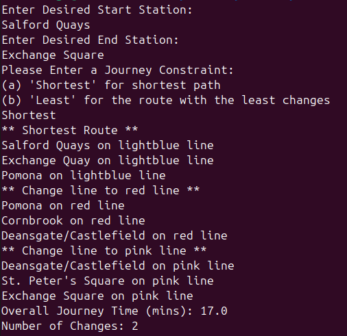

# Manchester Metrolink Route Planner

## Project Overview

Finds the optimal travel route between two stations on the Manchester Metrolink, based off of the conditions specified by the user:
- Fastest route.
- Fewest changes.

The program uses the assumption that changing between lines at stations takes exactly 2 minutes every time, this is a very general assumption and it would vary a lot in reality.

## Project Instructions

Run the following command to clone the project repository:
```
git clone https://github.com/Trimaz6855/metrolink_project.git
```

Make sure you have a file named ```Metrolink_times_linecolour.csv``` in the same folder as the code files for the project.

Compile the java files for the project using the following command:
```
javac *.java
```

The program can be run using:
```
java Program
```

An example usage of the program after the command is run is shown below:
- The user enters Salford Quays as the station they are starting at.
- The user entes Exchange Square as the station they are ending at.
- The user enters Shortest to select the shortest route journey constraint.


The available journey constraints are:
- "Shortest", finds and prints the shortest possible route between the start and end stations.
- "Least, finds and prints the route with the fewest changes between the start and end stations.

## Project Checklist

### Task 1
- **[ / ]** Read in station list and times between stations.
- **[ / ]** Create a graph using the stations and times between them.
- **[ ]** Create a GUI allowing the user to enter a valid start and end station with error checking.
    * Will initially implement as a command-line UI then will implement graphically later.

### Task 2 
- **[ / ]** Output a valid, not necessarily shortest, route between the start and end station.
- **[ / ]** Output a list including all intermediate stations.

### Task 3
- **[ / ]** Output the shortest route between the start and end station.
    * Current plan is to use Dijkstra's algorithm.
- **[ / ]** Output the list of intermediate stations and total journey time.
- **[ / ]** Output any line changes that occur on the journey.

### Task 4
- **[ / ]** Allow the user to select and use any journey conditions (examples given in the project overview).
- **[ / ]** Calculate the journey time based off of any selected conditions.
- **[ / ]** Output the total number of changes on the route.

### Task 5
- **[ ]** Allow the user to specify any station closures.
- **[ ]** Allow the user to specify any delays.
- **[ ]** Read in the walk times between stations.
    * Use the shortest time out of walking and tram line for each edge in Dijkstra's.
- **[ ]** Generate a visual graph of the route.
    * Generate inside a swing GUI.
    * Create custom drawable station and line objects.